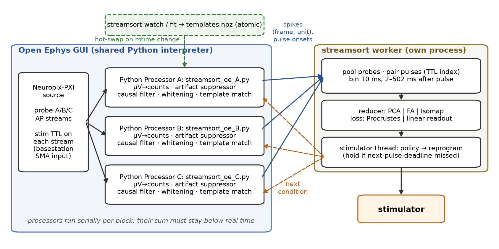
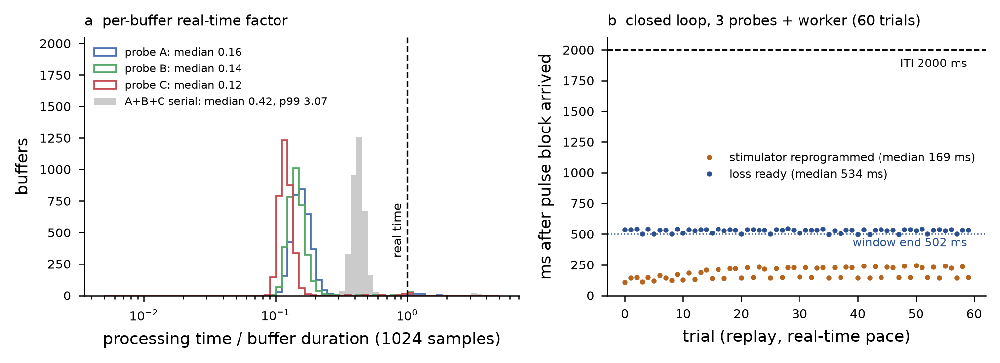

> **Branch `python` — Phase 2:** Open Ephys *Python Processor* path (one decoder script per probe stream, multiprocessing worker), `streamsort fit / watch / replay`. The current version is on `main` / `c++` (Phase 2b).
> License: GPL-3.0 (see `LICENSE`, `THIRD_PARTY.md`).

# streamsort

Online spike decoding and per-trial population geometry for closed-loop electrical stimulation,
validated by replaying pre-recorded Neuropixels data (DANDI 000774, jlh32 / jlh34) as a live stream.

* **fit** – Kilosort 4 on a leading segment → `templates.npz`, `whitening.npz`, `sorting_report.csv`
* **online decoder** – causal artifact suppression, filtering, whitening and template matching per probe
* **worker** – pools probes, bins each trial, reducer (PCA | FA | Isomap) + loss (Procrustes | linear readout), stimulator control

## Install

```
pip install -e .            # online path: numpy, scipy, numba, scikit-learn (no spikeinterface)
pip install -e ".[fit]"     # adds spikeinterface + kilosort for `streamsort fit` / `watch`
```
`fit` and `watch` run the Phase 1 scripts in `scripts/`, so they need this repository checkout.

## Command line

| command | does |
|---|---|
| `streamsort fit --rec-dir R --stream S --nch N --out O [--nwb F] [--seconds 600]` | sort → template bank → whitening; writes `O/streamsort_oe_<probe>.json` (plugin config). NWB optional (validation only); trials come from TTL edges. |
| `streamsort watch …same args… [--poll-s 5]` | live recording: waits until `continuous.dat` covers the segment on two consecutive polls, freezes a self-consistent snapshot (data, `.npy` arrays sized from file length, trimmed `structure.oebin`, TTL events up to the segment end; reads retried on Windows sharing errors), then runs `fit` on it. |
| `streamsort replay --session R --probe-config A.json [--probe-config B.json …] --t0 T [--worker-config W.json] [--pace 1]` | replays a recording through the plugin code path (GUI-sized float µV buffers, stim TTL injected on each probe stream). |
| `streamsort worker --config W.json` | live worker; start it before pressing play in the GUI. |

Template and whitening files are written atomically (`os.replace`), so a running decoder hot-swaps on
an mtime change without ever reading a partial file. A swap waits until ≥ 0.6 s after the last pulse,
and the new decoder is warmed on the last 15 ms of raw data.

## Open Ephys plugin

### Architecture


* **One Python Processor per probe AP stream** runs `oe/streamsort_oe_processor.py`.
  The GUI hands it float32 µV `(channels, samples)`, which it converts back to int16 counts
  (`rint(x / bit_volts)`, exact) and passes to the Phase 1 `OnlineDecoder`. The GUI buffer passes through unchanged.
* **No GUI spike events.** Spike frames, unit ids and pulse onsets go straight to the worker over
  `multiprocessing.connection`. No C++ spike-emitting processor is needed, because nothing downstream in the GUI consumes spikes.
* **The worker is a separate process.** The Python Processor shares one interpreter between all instances, and it never releases the GIL.
  Keeping analysis and stimulator I/O out of the GUI process means they cannot stall the signal chain.
* **Pulse timing:** the exact onset comes from the suppressor's clip detection. The stim TTL is paired with it to give each pulse a trial index,
  which aligns pulses across probes. A clip with no TTL within 50 ms is dropped. A TTL with no detected clip is sent at its block start.

### Requirements (rig checklist)

1. **Stim TTL on every probe stream.** A Python Processor only sees events from its own stream.
   Wire the stim trigger into the basestation sync/SMA input (or otherwise route it onto the probe streams).
   Set `"ttl_line"` in each probe JSON. Without a TTL, set `"ttl_line": null` to use artifact-only detection, with pulses paired across probes by time (±5 ms).
2. **One script copy per probe** (`streamsort_oe_A.py`, `streamsort_oe_B.py`, …) with a JSON of the same stem next to it.
   The module names must differ because the interpreter is shared. Example configs are in `results/phase2/configs/`.
3. **Python environment** = the one the Python Processor plugin was built against. Its CMake requires Python ≥ 3.10, and the env's minor version must match the build.
   Install `streamsort` into it (`pip install -e .`). The plugin script pins BLAS/OpenMP/numba to 1 thread before numpy loads.
4. **Start the worker first** (`streamsort worker --config worker.json`), then press play.
   Each processor connects in `start_acquisition` and does its JIT warm-up there. If the worker is unreachable, it decodes without it and logs a warning.
5. **Worker address:** `[host, port]` (TCP), a socket path (AF_UNIX) or `\\.\pipe\name` (Windows named pipe, which needs no firewall rule).
6. **Stimulator:** replace `DummyStimulator` (`program(condition)`, `reprog_s`) with the rig driver.
   Replace `SchedulePolicy` with the closed-loop policy. If programming cannot finish before the next pulse (ITI − 50 ms), the worker holds the current parameters.
7. **Budget check:** the processors run serially, so their summed time per block must stay below real time on average (see below).
   At the end of acquisition each processor prints its buffer-time median/p99 and swap count.

### Support matrix

| | macOS arm64 (M1, dev) | Windows x64 (rig) | Linux x64 |
|---|---|---|---|
| decoder core, worker, replay, tests | ✓ run here | not run | not run |
| Open Ephys GUI + Python Processor in the loop | **not run** | **not run** | not run |
| worker over Listener (TCP / AF_UNIX / named pipe) | code path present; sandbox forbids binding sockets, tested over `multiprocessing.Pipe` (same `Connection` API) | named pipe expected | AF_UNIX expected |
| numba kernels | ✓ | expected (numba wheels exist) | expected |

**arm64 note:** the plugin's CMake builds a universal binary (`arm64;x86_64`). The GUI, the plugin and the conda Python must all be the same architecture.
An x86_64 conda env under Rosetta will not load into an arm64 GUI. Measured timings are from an M1 (8 GB) and will differ on the rig.

**Not validated inside the GUI.** All results below come from the replay harness, which calls the plugin class's code path with GUI-shaped buffers and TTL events.
Running inside Open Ephys GUI v1.x, and on the Windows rig, remains to be done.

### Verification (jlh32, replay harness `scripts/replay_harness.py`)

| test | result |
|---|---|
| probe A, 60 s, 1024- and 512-sample buffers vs Phase 1 decoder | 62727 = 62727 spikes, identical; 30/30 pulses |
| mid-run atomic replace of `templates.npz` | 1 swap; spikes identical (62727) |
| A+B+C + worker process, 120 s at real-time pace | 60/60 trials, pulses paired on all 3 probes, condition sequence matches, 0 holds; spikes identical to the reference on every probe |
| pulse → loss ready / pulse → stimulator reprogrammed (100 ms) | median 534 / 169 ms, max 543 / 244 ms (ITI 2000 ms) |
| real-time factor per buffer, per probe (median) | A 0.16, B 0.14, C 0.12 |
| A+B+C serial | median 0.42, p99 3.07, max 3.45 (peaks: about 1 buffer per pulse, absorbed by the input FIFO) |



## Tests
```
python -m pytest tests -q          # Phase 1 + Phase 2 (tests/test_phase2.py); data-dependent tests skip without the recording
```
